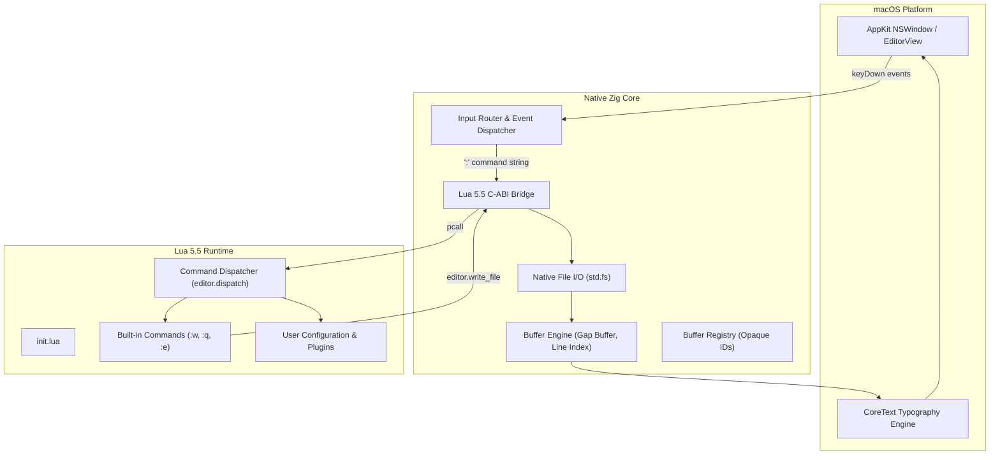

# 0001: Lua-Driven Architecture & Command Engine

## 1. Background / Context

Electronic Macdonalds is a native macOS GUI editor implemented in Zig with an embedded Lua 5.5 engine. 

The current codebase implements:
- A high-performance text buffer engine (gap buffer, line index, self-adjusting markers) in Zig.
- Cocoa/CoreText text rendering and typography in Objective-C/Zig.
- Basic Vim modal state machine (`normal`, `insert`, `command_line`) and navigation primitives in Zig.
- A raw Lua 5.5 C bridge exposing basic buffer mutations (`insert`, `delete`, `len`, `get_line`).

Currently, editor business logic—such as key translation, mode state tracking, and command-line handling—resides in Zig. While performant, this deviates from the core architectural philosophy of GNU Emacs, which operates as a minimal C substrate powering an extensible Lisp machine. In our architecture, **Zig serves as the C replacement**, and **embedded Lua 5.5 serves as the Elisp replacement**, while adhering to **Vim modal editing semantics**.

Hardcoding commands (`:w`, `:q`, `:e`), keymaps, and workflows into Zig creates unnecessary coupling and prevents live configuration and user extensibility.

---

## 2. Requirements / Goal

### 2.1 Desired Outcome
Shift all high-level editing business logic, command parsing/dispatching, and user configuration into Lua, leaving Zig strictly responsible for systems-level primitives (memory buffers, OS I/O, AppKit rendering, and the Lua VM runtime).

### 2.2 Functional Requirements
- **Lua Command Registry**: Lua provides an API (`editor.create_command(name, handler)`) to register `:` command handlers.
- **Built-in Lua Commands**: Standard commands (`:w`, `:q`, `:q!`, `:e <path>`, `:echo <msg>`) are implemented entirely in Lua.
- **Zig System Primitives**: Zig exposes low-level OS file operations to Lua via standardized 3-value returns:
  - `editor.read_file(path) -> (buf_id, nil, nil) | (nil, err_code, err_msg)`
  - `editor.write_file(buf_id, path) -> (true, nil, nil) | (nil, err_code, err_msg)`
  - `editor.quit(force) -> void`
- **Command Dispatch Pipeline**: When the user presses `<Enter>` in Command-Line Mode (`:`), Zig forwards the command string to Lua's `editor.dispatch_command(cmd_str)`.
- **Status Line Control**: Lua can set or format the status line text and error messages.

### 2.3 Non-Functional Requirements
- **Sub-millisecond Latency**: Command lookup and execution in Lua must complete in under 1 millisecond.
- **Memory Safety & Ownership**: Zig retains 100% ownership of buffer memory; Lua interacts solely via opaque 64-bit buffer IDs.
- **Robust Error Handling**: Lua runtime errors in user commands must be caught with `lua_pcallk` and reported gracefully in the status line without crashing the native application.

### 2.4 Out of Scope
- Multi-window split layouts (`:split`, `:vsplit`).
- Tree-sitter or complex regex syntax highlighting engines.
- Asynchronous LSP (Language Server Protocol) client.

---

## 3. Proposal

### 3.1 Architecture Overview



### 3.2 Division of Responsibilities

1. **Zig Core Responsibilities**:
   - Allocate and manage text buffers and markers.
   - Execute fast memory mutations (`insert`, `delete`, `move_gap`).
   - Read files from disk into buffers and write buffer slices to disk.
   - Render lines via CoreText.
   - Pass raw input events to the active mode state machine.
   - Call Lua functions via protected calls (`lua_pcallk`).

2. **Lua Engine Responsibilities**:
   - Parse command-line strings (extracting command name and arguments).
   - Route commands to registered callbacks.
   - Handle buffer lifecycle business logic (e.g., check if buffer is dirty before quitting).
   - Format status line contents and display feedback messages.

### 3.3 Lua API Specification

#### C-to-Lua Exposed Primitives (`editor.*` table)
```lua
-- File I/O
local buf_id, err, msg = editor.read_file("/path/to/file.txt")
local ok, err, msg = editor.write_file(buf_id, "/path/to/file.txt")

-- Application Control
editor.quit(force_boolean)

-- Status Line & Notifications
editor.set_status(message_string)
editor.set_error(error_message_string)
```

#### Lua Command Registry (`lua/editor/commands.lua`)
```lua
editor.commands = {}

function editor.create_command(name, fn)
    editor.commands[name] = fn
end

function editor.dispatch_command(line)
    -- Trim leading ':' and split into command and arguments
    local raw = line:match("^:?(.*)$")
    local name, args = raw:match("^(%S+)%s*(.-)$")
    if not name then return end

    local handler = editor.commands[name]
    if handler then
        local ok, err = pcall(handler, args)
        if not ok then
            editor.set_error("Error: " .. tostring(err))
        end
    else
        editor.set_error("Not an editor command: " .. name)
    end
end
```

### 3.4 Trade-offs Considered

- **Pure Zig Command Logic**:
  - *Pros*: Slightly smaller binary footprint, zero Lua crossing for commands.
  - *Cons*: Cannot reload or customize commands at runtime; violates Emacs-style extensibility; requires recompilation for every new command.
- **Embedded Lua Command Logic (Chosen)**:
  - *Pros*: Matches GNU Emacs extensibility model; clean separation of concerns; fast prototyping; user scriptable `init.lua`.
  - *Cons*: Requires establishing and maintaining Lua C-API binding surfaces for OS and editor operations.

---

## 4. Task List

- [ ] **Phase 1: File I/O Primitives in Zig**
  - [ ] Implement `read_file(allocator, path)` in `src/buffer/buffer.zig` to populate gap buffer from disk.
  - [ ] Implement `write_file(buf, path)` in `src/buffer/buffer.zig` to write gap buffer contents to disk.
  - [ ] Add unit tests for buffer read/write operations (TDD).

- [ ] **Phase 2: Lua File I/O & System Bindings**
  - [ ] Bind `editor.read_file(path)` in `src/lua/editor_binding.zig`.
  - [ ] Bind `editor.write_file(buf_id, path)` in `src/lua/editor_binding.zig`.
  - [ ] Bind `editor.quit(force)` in `src/lua/editor_binding.zig`.
  - [ ] Add unit tests verifying Lua 3-value returns on success and failure.

- [ ] **Phase 3: Lua Command Dispatcher & Core Commands**
  - [ ] Create `runtime/lua/editor/init.lua` with command parser and registry.
  - [ ] Implement `:w [path]` in Lua.
  - [ ] Implement `:q` and `:q!` in Lua with buffer dirty tracking.
  - [ ] Implement `:e <path>` in Lua.
  - [ ] Implement `:echo <args>` in Lua.

- [ ] **Phase 4: Wire Command-Line Mode to Lua Dispatcher**
  - [ ] Connect `EditorState` `<Enter>` key event in command-line mode to call `editor.dispatch_command(cmd)` in Lua.
  - [ ] Propagate Lua status and error feedback into the bottom status line.
  - [ ] Verify interactively in Cocoa GUI window.
